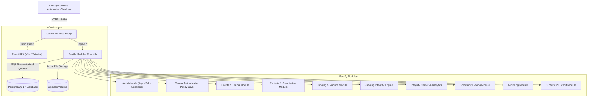
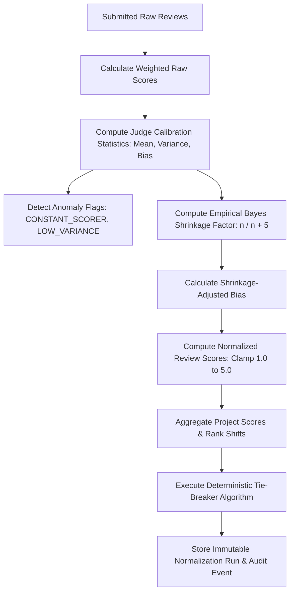

# System Architecture — DOGFOOD 2026

## 1. Architectural Philosophy: Modular Monolith

DOGFOOD 2026 is designed as a **Modular Monolith**. Rather than introducing distributed microservices with fragile network hops, eventual consistency pitfalls, and operational overhead, all domain services reside within a single cohesive backend with strictly enforced internal module boundaries.

### Core Tenets:
1. **Zero External Cloud Dependencies**: The platform operates fully self-contained on localhost or single-node production environments without relying on third-party SaaS for authentication, databases, or object storage.
2. **Relational Consistency**: Critical multi-step workflows—including fixture imports, review submissions, and normalization runs—execute inside ACID database transactions.
3. **Defense in Depth**: Authorization and deadline checks are enforced on the Fastify server layer regardless of frontend state.
4. **Reproducibility**: Statistical algorithms (judge bias calibration, shrinkage normalization, ballot shuffling, ranking tie-breaks) are deterministic and mathematically documented.

---

## 2. High-Level Component Diagram



---

## 3. Layered Design & Boundaries

### 3.1 Caddy Gateway & Static Proxy
Caddy serves as the single unified entry point on port 8080:
- Serves pre-compiled production frontend static assets (`apps/web/dist`).
- Re-writes client-side route paths to `/index.html` for HTML5 pushState routing.
- Reverse-proxies all `/api/*` traffic to the Fastify backend on port 8080 (or `api:8080` in Docker), forwarding real client IPs via `X-Real-IP`.

### 3.2 Frontend Architecture (`apps/web`)
- **Technology Stack**: React 18, TypeScript, Vite, Tailwind CSS, Lucide React, and TanStack Query.
- **State & Data Caching**: TanStack Query manages API server state, automatic caching, and background refetching.
- **Role Evaluation Switcher**: Built-in persona switcher enables live evaluation of permission barriers between Visitors, Organizers, Judges, and Participants.
- **Component Organization**: Feature-sliced into `gallery`, `results`, `voting`, `participant`, `judge`, and `organizer`.

### 3.3 Backend Architecture (`apps/api`)
- **Framework**: Fastify 5 with strict TypeScript.
- **Middleware Pipeline**:
  1. `requestId`: Generates and propagates a unique UUID for every incoming request.
  2. `pino`: Structured JSON logging recording method, route, status, duration, and user ID.
  3. `@fastify/cookie`: Parses HttpOnly cookies for session authentication.
  4. `@fastify/cors`: Configured for origin isolation.
  5. `@fastify/rate-limit`: Protects sensitive routes (login, voting) from abuse.
  6. `authMiddleware`: Attaches authenticated user context and event-scoped role map.

---

## 4. Authentication & Authorization Architecture

### 4.1 Authentication Workflow
```mermaid
sequenceDiagram
    autonumber
    actor Client
    participant Fastify as Fastify API
    participant DB as PostgreSQL

    Client->>Fastify: POST /api/v1/auth/login (email, password)
    Fastify->>DB: Query user by email
    Fastify->>Fastify: Verify password with Argon2id
    Fastify->>DB: Insert into sessions (id, user_id, expires_at)
    Fastify-->>Client: Set-Cookie: session=<token>; HttpOnly; SameSite=Lax
```

1. **Password Hashing**: State-of-the-art Argon2id hashing via `@node-rs/argon2`.
2. **Session Storage**: Opaque session tokens stored in the `sessions` PostgreSQL table. Persistent across application restarts without requiring Redis.
3. **Deterministic Acceptance Testing**: In testing mode, the system provisions fixed session keys (e.g., `dogfood_org_session_token_2026`) directly linked to seeded fixture users for non-interactive acceptance test suites.

### 4.2 Central Authorization Policy Layer
Authorization is centralized in `apps/api/src/policies/index.ts`. All endpoint handlers delegate permission decisions to `authorize()`:

```typescript
authorize({
  actor: RequestUser | null,
  action: PolicyAction,
  resource: PolicyResource
}): boolean
```

#### Permission Matrix:

| Action | Visitor | Participant | Judge (Assigned) | Judge (Peer) | Organizer | Platform Admin |
| :--- | :---: | :---: | :---: | :---: | :---: | :---: |
| `PROJECTS.VIEW_PUBLIC` | ✅ | ✅ | ✅ | ✅ | ✅ | ✅ |
| `PROJECTS.SUBMIT` | ❌ | ✅ (before deadline) | ❌ | ❌ | ✅ | ✅ |
| `JUDGING.VIEW_ASSIGNED`| ❌ | ❌ | ✅ | ❌ | ✅ | ✅ |
| `JUDGING.VIEW_OWN_SCORES`| ❌ | ❌ | ✅ | ❌ | ✅ | ✅ |
| `JUDGING.VIEW_PEER_SCORES`| ❌ | ❌ | ❌ (403) | ❌ (403) | ✅ | ✅ |
| `EVENT.MANAGE_INTEGRITY`| ❌ | ❌ | ❌ | ❌ | ✅ | ✅ |
| `RESULTS.PUBLISH` | ❌ | ❌ | ❌ | ❌ | ✅ | ✅ |
| `VOTE.CAST` | ✅ (1 per hash) | ✅ (1 per hash) | ✅ | ✅ | ✅ | ✅ |

---

## 5. Judging Engine & Normalization Pipeline

The judging engine (`packages/judging-engine`) operates as a pure TypeScript domain library with zero side effects:



### Transactional Guarantees
Normalization runs are executed inside a single PostgreSQL transaction:
1. `normalization_runs`: Records metadata, algorithm version, and hyperparameters ($k=5$).
2. `normalized_reviews`: Stores individual review-level adjustment breakdowns for transparency.
3. `judge_statistics`: Persists calibration metrics and anomaly flags.
4. `project_results`: Stores final raw vs. normalized ranks and shifts.
5. `audit_events`: Emits an immutable `NORMALIZATION.RUN` record.

If any constraint fails, the transaction rolls back completely.

---

## 6. Monorepo Organization

```text
dogfood-platform/
├── apps/
│   ├── api/                     # Fastify REST Backend
│   │   ├── src/modules/         # Feature modules (auth, judging, etc.)
│   │   ├── src/policies/        # Central policy definitions
│   │   └── Dockerfile
│   └── web/                     # React Vite SPA Frontend
│       ├── src/features/        # Feature pages (gallery, judge, organizer)
│       └── Dockerfile
├── packages/
│   ├── shared/                  # Common Zod schemas, types, constants
│   ├── database/                # Drizzle ORM schema, client, migrations
│   ├── judging-engine/          # Pure normalization & statistics engine
│   └── fixture-importer/        # Safe fixture parser, validator & seeder
├── infrastructure/
│   └── caddy/                   # Caddyfile and multi-stage Dockerfile
├── tests/
│   ├── unit/                    # Engine unit tests
│   └── api/                     # Acceptance and API integration tests
└── docker-compose.yml
```
